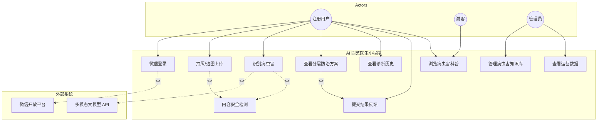
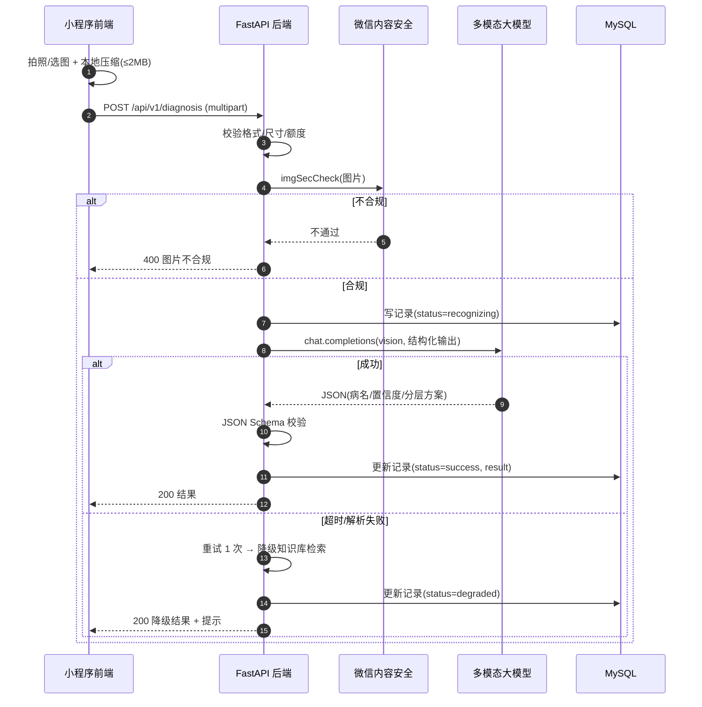
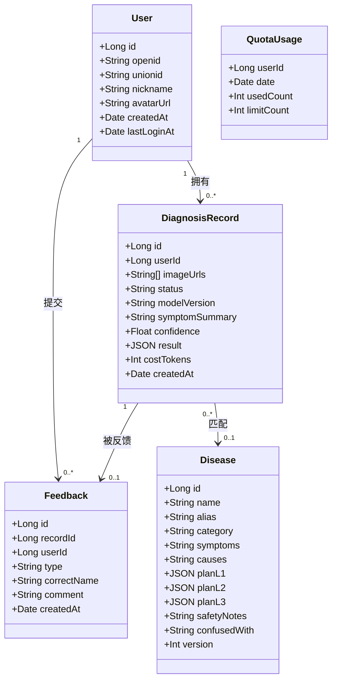
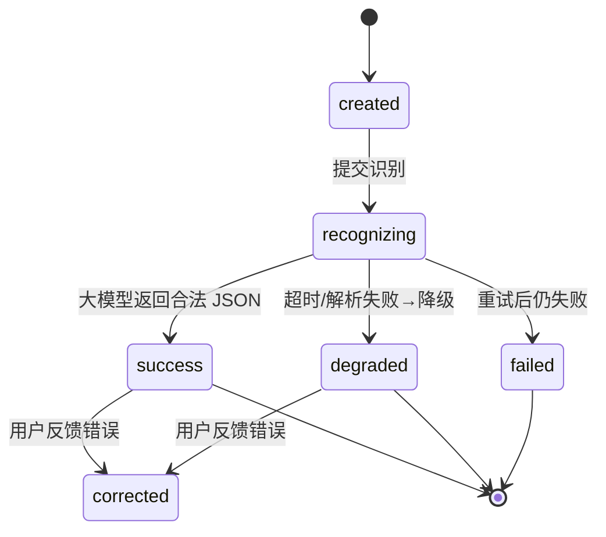
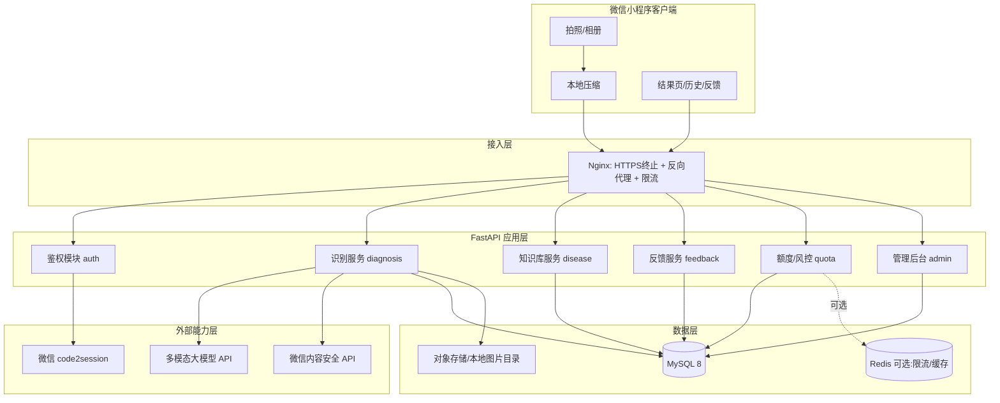
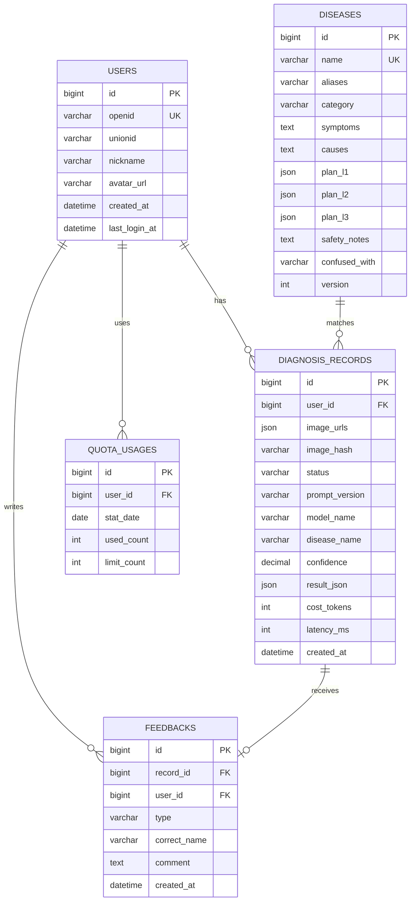
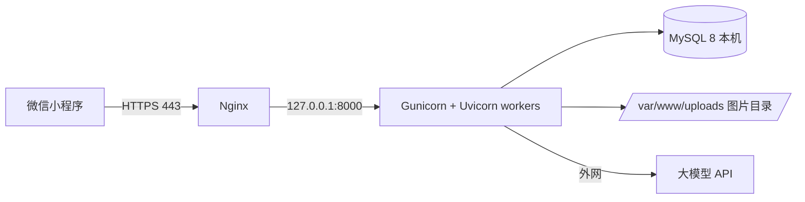

# AI 园艺医生 · 项目开发准备文档

> 版本：v1.0（MVP，1 个月落地）
> 载体：微信小程序
> 后端：FastAPI + MySQL + 多模态大模型 API
> 本文档覆盖：需求分析（UML）、系统分析与设计、技术栈选型、功能清单、部署与上线教程
> 子任务拆分见独立文档：[任务清单](./任务清单.md)

---

## 目录

- [1. 项目概览](#1-项目概览)
- [2. 需求分析](#2-需求分析)
- [3. 系统分析与设计](#3-系统分析与设计)
- [4. 技术栈选型](#4-技术栈选型)
- [5. 功能清单](#5-功能清单)
- [6. 子任务拆分](./任务清单.md)（已抽取为独立文档）
- [7. 项目部署教程](#7-项目部署教程)
- [8. 风险与应对](#8-风险与应对)
- [9. 附录](#9-附录)

---

## 1. 项目概览

### 1.1 一句话定位

面向家庭园艺 / 阳台种菜新手，**拍照即识别病虫害，输出家庭友好型（对儿童、宠物安全）的分层防治方案**的微信小程序。

### 1.2 要解决的问题

| 痛点 | 现状 | 本项目的解法 |
| --- | --- | --- |
| 识别难 | 新手不认识病症，图文搜索要在几十篇文章里翻找，关键词也不知道怎么描述 | 拍一张叶/茎/果的清晰照片即可，无需专业术语 |
| 结果杂乱 | 搜索结果混杂农资广告、论坛帖子、专业论文，可信度不明 | 单一权威结论 + 症状确认点 + 易混淆项对照 |
| 方案不安全 | 大量工具/教程默认推荐高毒农药，家庭场景有儿童、宠物 | **分层防治方案**：L1 家庭安全 → L2 低毒合规 → L3 专业干预，并强制安全提示 |
| 用完就忘 | 记录散落、无法回溯，不知道"上次那盆是不是又犯了" | 诊断历史 + 复诊提醒 + 反馈纠错闭环 |

### 1.3 MVP 范围边界

**做**：拍照识别、分层防治方案、诊断历史、反馈纠错、基础用户体系。

**不做（1 个月内明确砍掉）**：自研 CV 模型、社区/论坛、电商导购、专家图文问诊、多作物品种库管理、iOS/Android 原生 App、付费会员体系。

### 1.4 成功指标（上线首月）

| 指标 | 目标值 | 说明 |
| --- | --- | --- |
| 识别成功率 | ≥ 92% | 大模型返回结构化结果且不降级的比例 |
| 单次识别耗时 | P95 ≤ 8s | 从拍照到结果页可见 |
| 单次识别成本 | ≤ 0.05 元 | 含图片 Token 与输出 Token |
| 用户反馈"有帮助"占比 | ≥ 80% | 结果页点赞率 |
| 反馈纠错率 | ≤ 10% | 用户点"识别错误"的比例，用于迭代 Prompt |

---

## 2. 需求分析

### 2.1 角色识别（Actors）

| 角色 | 类型 | 说明 |
| --- | --- | --- |
| 游客（未登录用户） | 主要 | 可浏览示例、看科普，识别时需登录授权 |
| 注册用户（家庭种植者） | 主要 | 拍照识别、看方案、查历史、反馈 |
| 运营/管理员 | 次要 | 维护病虫害知识库、查看数据、处理举报 |
| 大模型服务（外部系统） | 支撑 | 提供多模态识别能力 |
| 微信开放平台（外部系统） | 支撑 | 登录鉴权、内容安全、消息订阅 |

### 2.2 用户痛点 → 需求映射

| 用户目标 | 需求 | 优先级 |
| --- | --- | --- |
| 快速知道"我的植物怎么了" | 拍照识别病虫害，返回名称 + 置信度 | P0 |
| 知道"该怎么治，又不伤家人宠物" | 分层防治方案（L1/L2/L3）+ 安全提示 | P0 |
| 确认结果可信 | 症状确认点、易混淆项对照、置信度展示 | P0 |
| 回头看之前的诊断 | 诊断历史列表 + 详情 | P1 |
| 结果错了要能纠正 | 反馈"识别错误"并提交正确名称 | P1 |
| 不想被广告和高毒药推销 | 无农药导购、方案以家庭安全为先 | P0 |
| 少花钱、少等待 | 免费额度、结果缓存、失败自动重试 | P1 |
| 懂一点基础知识 | 常见病虫害科普页 | P2 |

### 2.3 功能需求（FR）

| 编号 | 需求 | 说明 |
| --- | --- | --- |
| FR-01 | 微信一键登录 | 静默 `wx.login` 换 code → 后端 `code2session` → 建/查用户 |
| FR-02 | 拍照 / 相册选图 | 支持拍照与相册，最多 3 张 |
| FR-03 | 图片预处理 | 前端压缩 + 后端校验（尺寸、大小、格式、内容安全） |
| FR-04 | 多模态识别 | 调用大模型，返回结构化 JSON |
| FR-05 | 分层防治方案展示 | L1/L2/L3 三档，含安全提示 |
| FR-06 | 置信度与不确定性表达 | < 阈值时提示"建议补拍" |
| FR-07 | 诊断历史 | 分页列表 + 详情回看 |
| FR-08 | 反馈纠错 | 点赞 / 报错 + 提交正确病名 |
| FR-09 | 免费额度与限流 | 每日 N 次，防刷 |
| FR-10 | 订阅消息提醒 | 用药/复查提醒（可选，P2） |
| FR-11 | 知识库管理（后台） | 管理员增删改病虫害知识 |
| FR-12 | 内容安全检测 | 图片与文本过微信安全接口 |

### 2.4 非功能需求（NFR）

| 类别 | 要求 |
| --- | --- |
| 性能 | 图片上传 ≤ 2s（≤ 2MB），识别 P95 ≤ 8s，首页首屏 ≤ 1.5s |
| 并发 | MVP 支撑 200 并发 / 日活 5,000 |
| 可用性 | 大模型不可用时可降级（知识库检索 / 友好报错），核心链路可用性 ≥ 99% |
| 安全 | HTTPS 全链路、接口鉴权（JWT/session）、防刷限流、图片不落公开目录 |
| 合规 | ICP 备案、小程序备案、用户隐私保护指引、生成式 AI 内容合规、类目选择 |
| 成本 | 单次识别 ≤ 0.05 元，月度大模型预算可控（设熔断上限） |
| 可维护 | 结构化日志、结果落库可追溯、Prompt 版本化 |

### 2.5 用例图（UML Use Case）



### 2.6 核心用例描述

**UC-03 识别病虫害**

| 项 | 内容 |
| --- | --- |
| 用例编号 | UC-03 |
| 参与者 | 注册用户、多模态大模型 API、微信内容安全 |
| 前置条件 | 已登录；已选 1–3 张图片；当日额度未用完 |
| 触发条件 | 用户点击"开始识别" |
| 主流程 | 1. 前端压缩图片并上传 → 2. 后端校验格式/大小 → 3. 调用内容安全接口 → 4. 组装 Prompt 与图片调用大模型 → 5. 校验 JSON Schema → 6. 结果与图片落库 → 7. 返回结果页 |
| 备选流程 | 3a 内容安全不通过 → 提示"图片不合规"并终止；5a JSON 解析失败 → 重试 1 次，仍失败则降级 |
| 异常流程 | 超时（>15s）→ 返回"识别超时，请重试"；额度耗尽 → 提示开通/等次日 |
| 后置条件 | `diagnosis_records` 新增一条记录，状态为 `success`/`degraded`/`failed` |

**UC-06 提交反馈**

| 项 | 内容 |
| --- | --- |
| 前置条件 | 存在一条属于自己的诊断记录 |
| 主流程 | 1. 用户点"识别错误" → 2. 填写正确病名/描述 → 3. 提交 → 4. 写入 `feedback`，标记记录 `corrected` |
| 后置条件 | 反馈进入运营后台，用于 Prompt 与知识库迭代 |

### 2.7 关键流程 —— 识别时序图（UML Sequence）



### 2.8 领域模型（UML Class Diagram）



### 2.9 记录状态机（UML State Machine）



---

## 3. 系统分析与设计

### 3.1 总体架构



**设计取舍说明**

- **同步返回**（而非任务队列）：MVP 单次识别在 8s 内，用户等待可接受，省掉 Celery/消息队列的复杂度。若后期耗时上升再引入异步 + 轮询。
- **图片存对象存储**：MVP 可先用服务器本地目录（挂载卷），上线量起来后切 OSS/COS，接口层用 `storage` 抽象隔离，不改业务代码。
- **Redis 可选**：MVP 用 MySQL 计数即可满足限流，Redis 属于"有余力再做"。

### 3.2 模块划分

| 模块 | 职责 | 关键类/文件 |
| --- | --- | --- |
| `auth` | 微信登录、Token 签发与校验、用户建档 | `routers/auth.py`, `services/wechat.py` |
| `diagnosis` | 图片校验、识别编排、降级、落库 | `routers/diagnosis.py`, `services/recognizer.py`, `services/degrade.py` |
| `disease` | 知识库 CRUD、按名检索、科普 | `routers/disease.py` |
| `feedback` | 点赞/报错、纠错入库 | `routers/feedback.py` |
| `quota` | 每日额度、限流、成本熔断 | `services/quota.py` |
| `admin` | 后台管理接口（知识库、数据看板） | `routers/admin.py` |
| `common` | 配置、日志、DB 会话、异常、响应包装 | `core/*` |

### 3.3 核心链路：识别流水线设计

```
选图 → 前端压缩(≤2MB, 长边≤1280) → 上传
   → 后端:
      1) 基础校验: MIME/大小/像素
      2) 内容安全: imgSecCheck
      3) 额度校验: 当日 used < limit（超限 429）
      4) 缓存命中检查: 图片 sha256 已有同日同模型结果 → 直接复用
      5) 组装 messages(img + 结构化 Prompt) → 调大模型
      6) 解析 + JSON Schema 校验（失败重试 1 次，temperature 降低）
      7) 成功 → success；失败 → degrade（知识库关键词检索）→ degraded
      8) 落库 + 记录 token 与耗时
   → 返回结构体给前端
```

**关键约定（踩坑点，提前定死）**

- 大模型输出**必须用 JSON 强约束**（`response_format=json_object` 或 function calling），否则自由文本解析极易失败。
- 图片约定**长边不超过 1280px**，再大对识别精度无提升，只烧 Token。
- 前端压缩用 `wx.compressImage` + canvas，**不要依赖后端压缩**，省带宽且降低超时。
- 上传接口用 `multipart/form-data`，单张 ≤ 2MB，最多 3 张，超限直接拒绝。
- 识别链路**所有耗时段落打点**，方便定位是大模型慢还是网络慢。

### 3.4 大模型集成设计

#### 3.4.1 结构化输出 Schema（结果契约）

```json
{
  "disease_name": "番茄早疫病",
  "aliases": ["轮纹病"],
  "category": "真菌性病害",
  "confidence": 0.86,
  "severity": "moderate",
  "symptom_summary": "叶片出现深褐色同心轮纹斑，边缘黄化，下部老叶先发病。",
  "confirm_points": [
    "病斑有同心轮纹（靶心状）",
    "从下部老叶向上发展",
    "高湿环境下病斑边缘有浅色霉层"
  ],
  "confused_with": [
    {"name": "番茄晚疫病", "key_difference": "晚疫病斑边缘不清晰、水渍状，扩展极快"}
  ],
  "plan_l1_safe": {
    "title": "家庭零风险处置（有儿童/宠物首选）",
    "items": [
      "立即摘除病叶病果，装袋密封丢弃，不要丢进堆肥",
      "增加通风，避免叶面长时间挂水",
      "基部浇水，不要从叶面淋水"
    ]
  },
  "plan_l2_low_toxicity": {
    "title": "低毒合规处置（按说明书使用，注意安全间隔期）",
    "items": [
      {"name": "枯草芽孢杆菌", "usage": "1000 倍液叶面喷雾，7 天一次，连用 2–3 次"},
      {"name": "代森锰锌", "usage": "按登记剂量使用，采收前 15 天停止"}
    ],
    "note": "家庭阳台建议优先 L1，L2 仅在病情发展较快时使用"
  },
  "plan_l3_professional": {
    "title": "专业干预（家庭场景不建议自行操作）",
    "items": ["病情大面积爆发或反复发作时，联系当地植保站/专业园艺服务"],
    "risk_note": "涉及中高毒药剂与专业施药设备，家庭环境存在安全风险"
  },
  "safety_notes": [
    "所有药剂置于儿童与宠物接触不到处",
    "施药后洗手，当天避免宠物舔舐叶片",
    "食用部位采收前务必遵守安全间隔期"
  ],
  "need_more_info": false,
  "followup_questions": []
}
```

**为什么这么设计**

- `confidence` + `confirm_points` 一起给：用户自己能对照验证，降低"AI 说啥就信啥"的误判风险。
- `confused_with` 是差异化细节：新手最容易把早疫病和晚疫病搞混，给出**关键区分点**比给一堆病名有价值。
- `plan_l1/l2/l3` 分层强制存在：即使模型认为必须用药，L1 也必须给出物理/生物处置方法，保证"家庭安全优先"这个产品主张不被模型带偏。
- `safety_notes` 独立字段：前端固定高亮展示，不藏在正文里。

#### 3.4.2 Prompt 策略（要点）

1. **角色设定**：家庭园艺病虫害诊断专家，输出必须严格符合给定 JSON Schema。
2. **安全护栏**：明确"面向有儿童和宠物的家庭场景，禁止推荐高毒农药；必须提供 L1 物理/生物方案"。
3. **不确定性约束**：图片不清晰或信息不足时，`confidence` 必须 ≤ 0.5，且 `need_more_info=true` 并给出补拍建议，**不得编造**。
4. **拒绝越界**：非植物/无法判断时返回 `disease_name="无法识别"`。
5. **版本化**：Prompt 存为模板文件并带版本号，写入记录，便于 A/B 与回滚。

#### 3.4.3 降级与容错

| 场景 | 策略 |
| --- | --- |
| 大模型超时（>15s） | 重试 1 次（指数退避），仍失败 → 知识库关键词检索 |
| JSON 解析失败 | 降低 temperature 重试 1 次；仍失败 → 降级 |
| 服务整体不可用 | 返回"识别服务繁忙"，不扣额度，引导稍后再试 |
| 成本超月预算 | 熔断：识别排队并提示"当前人数较多" |
| 内容安全不通过 | 直接拒绝，不消耗额度 |

#### 3.4.4 成本控制

- 图片降采样（长边 ≤ 1280）、单次最多 3 张。
- `max_tokens` 限制输出（如 1200）。
- 结果缓存：`sha256(图片) + prompt_version + model` 作为 key，命中直接返回。
- 每日免费额度 + 全站日成本上限（超过则熔断）。

### 3.5 数据库设计

#### 3.5.1 ER 图



#### 3.5.2 建表 SQL（MySQL 8）

```sql
CREATE DATABASE IF NOT EXISTS gardening_doctor
  DEFAULT CHARACTER SET utf8mb4 COLLATE utf8mb4_unicode_ci;

USE gardening_doctor;

-- 用户表
CREATE TABLE users (
  id            BIGINT UNSIGNED NOT NULL AUTO_INCREMENT,
  openid        VARCHAR(64)  NOT NULL COMMENT '微信 openid',
  unionid       VARCHAR(64)  DEFAULT NULL,
  nickname      VARCHAR(64)  DEFAULT NULL,
  avatar_url    VARCHAR(512) DEFAULT NULL,
  created_at    DATETIME     NOT NULL DEFAULT CURRENT_TIMESTAMP,
  last_login_at DATETIME     DEFAULT NULL,
  PRIMARY KEY (id),
  UNIQUE KEY uk_openid (openid)
) ENGINE=InnoDB COMMENT='用户';

-- 诊断记录表
CREATE TABLE diagnosis_records (
  id             BIGINT UNSIGNED NOT NULL AUTO_INCREMENT,
  user_id        BIGINT UNSIGNED NOT NULL,
  image_urls     JSON           NOT NULL COMMENT '图片地址数组',
  image_hash     CHAR(64)       DEFAULT NULL COMMENT '首图 sha256，用于缓存命中',
  status         VARCHAR(16)    NOT NULL DEFAULT 'created' COMMENT 'created/recognizing/success/degraded/failed/corrected',
  prompt_version VARCHAR(16)    DEFAULT NULL,
  model_name     VARCHAR(64)    DEFAULT NULL,
  disease_name   VARCHAR(64)    DEFAULT NULL,
  confidence     DECIMAL(4,3)   DEFAULT NULL,
  result_json    JSON           DEFAULT NULL COMMENT '结构化识别结果',
  cost_tokens    INT            NOT NULL DEFAULT 0,
  latency_ms     INT            NOT NULL DEFAULT 0,
  created_at     DATETIME       NOT NULL DEFAULT CURRENT_TIMESTAMP,
  PRIMARY KEY (id),
  KEY idx_user_time (user_id, created_at),
  KEY idx_hash (image_hash)
) ENGINE=InnoDB COMMENT='诊断记录';

-- 病虫害知识库
CREATE TABLE diseases (
  id            BIGINT UNSIGNED NOT NULL AUTO_INCREMENT,
  name          VARCHAR(64)  NOT NULL,
  aliases       VARCHAR(255) DEFAULT NULL,
  category      VARCHAR(32)  DEFAULT NULL COMMENT '真菌性/细菌性/病毒性/虫害/生理性',
  symptoms      TEXT,
  causes        TEXT,
  plan_l1       JSON COMMENT '家庭安全处置',
  plan_l2       JSON COMMENT '低毒合规处置',
  plan_l3       JSON COMMENT '专业干预',
  safety_notes  TEXT,
  confused_with VARCHAR(255) DEFAULT NULL,
  version       INT          NOT NULL DEFAULT 1,
  created_at    DATETIME     NOT NULL DEFAULT CURRENT_TIMESTAMP,
  updated_at    DATETIME     NOT NULL DEFAULT CURRENT_TIMESTAMP ON UPDATE CURRENT_TIMESTAMP,
  PRIMARY KEY (id),
  UNIQUE KEY uk_name (name),
  KEY idx_category (category)
) ENGINE=InnoDB COMMENT='病虫害知识库';

-- 反馈表
CREATE TABLE feedbacks (
  id           BIGINT UNSIGNED NOT NULL AUTO_INCREMENT,
  record_id    BIGINT UNSIGNED NOT NULL,
  user_id      BIGINT UNSIGNED NOT NULL,
  type         VARCHAR(16) NOT NULL COMMENT 'like/dislike/wrong',
  correct_name VARCHAR(64) DEFAULT NULL,
  comment      TEXT,
  created_at   DATETIME    NOT NULL DEFAULT CURRENT_TIMESTAMP,
  PRIMARY KEY (id),
  KEY idx_record (record_id)
) ENGINE=InnoDB COMMENT='用户反馈';

-- 额度表
CREATE TABLE quota_usages (
  id          BIGINT UNSIGNED NOT NULL AUTO_INCREMENT,
  user_id     BIGINT UNSIGNED NOT NULL,
  stat_date   DATE NOT NULL,
  used_count  INT  NOT NULL DEFAULT 0,
  limit_count INT  NOT NULL DEFAULT 10,
  PRIMARY KEY (id),
  UNIQUE KEY uk_user_date (user_id, stat_date)
) ENGINE=InnoDB COMMENT='每日额度';

-- 管理员
CREATE TABLE admins (
  id            BIGINT UNSIGNED NOT NULL AUTO_INCREMENT,
  username      VARCHAR(32) NOT NULL,
  password_hash VARCHAR(128) NOT NULL,
  created_at    DATETIME NOT NULL DEFAULT CURRENT_TIMESTAMP,
  PRIMARY KEY (id),
  UNIQUE KEY uk_username (username)
) ENGINE=InnoDB COMMENT='后台管理员';
```

### 3.6 API 设计（REST）

> 完整的接口契约（请求/响应字段、错误码、调用示例、联调约定）见独立文档：[API接口文档](./API接口文档.md)

统一前缀 `/api/v1`，统一响应包装：

```json
{ "code": 0, "message": "ok", "data": {}, "trace_id": "..." }
```

| 方法 | 路径 | 说明 | 鉴权 |
| --- | --- | --- | --- |
| POST | `/auth/login` | code2session 登录，返回 token | 否 |
| GET | `/user/profile` | 当前用户信息 | 是 |
| POST | `/diagnosis` | 上传图片并发起识别 | 是 |
| GET | `/diagnosis/{id}` | 查询单条结果 | 是 |
| GET | `/diagnosis` | 历史列表（分页） | 是 |
| GET | `/quota` | 今日剩余额度 | 是 |
| GET | `/diseases` | 科普列表 / 搜索 | 否 |
| GET | `/diseases/{id}` | 科普详情 | 否 |
| POST | `/feedback` | 提交反馈 | 是 |
| POST | `/admin/login` | 后台登录 | 否 |
| GET/POST/PUT/DELETE | `/admin/diseases` | 知识库维护 | 管理员 |
| GET | `/admin/stats` | 运营数据看板 | 管理员 |

**`POST /diagnosis` 请求示例**

```
Content-Type: multipart/form-data
fields:
  images: <file> <file> <file>   # 1-3 张
  plant_hint: "番茄"             # 可选
  client_ts: 1697000000000
```

**响应示例**

```json
{
  "code": 0,
  "message": "ok",
  "data": {
    "record_id": 1024,
    "status": "success",
    "disease_name": "番茄早疫病",
    "confidence": 0.86,
    "plan_l1_safe": { "...": "..." },
    "plan_l2_low_toxicity": { "...": "..." },
    "plan_l3_professional": { "...": "..." },
    "safety_notes": ["..."],
    "remaining_quota": 7
  }
}
```

### 3.7 安全与合规设计（上线硬约束）

| 项 | 措施 |
| --- | --- |
| 传输安全 | 小程序 `request`/`uploadFile` 域名必须 **HTTPS + 已备案** |
| 鉴权 | 登录换自定义 token（JWT，有效期 7 天），敏感接口校验 |
| 内容安全 | 图片 `imgSecCheck`、文本 `msgSecCheck`（上线必接，否则审核不通过） |
| 隐私合规 | 小程序后台配置《用户隐私保护指引》，声明收集头像昵称、相册/相机权限；首次使用弹窗授权 |
| 生成式 AI | 使用已通过备案的第三方大模型 API（通义/豆包/智谱等），并在页面注明"AI 生成内容仅供参考" |
| 类目选择 | 建议 `工具 → 信息查询`，避免进入需资质的教育/医疗类目 |
| 免责声明 | 结果仅供参考，严重情况建议咨询专业植保人员 |
| 数据保护 | 图片私有存储、不公开直链；日志脱敏；提供注销入口 |

---

## 4. 技术栈选型

### 4.1 选型总表

| 层 | 选型 | 版本建议 | 理由 |
| --- | --- | --- | --- |
| 客户端 | 微信小程序原生（WXML/WXSS/JS） | 基础库 ≥ 3.0 | 体量小、加载快，MVP 无需跨端框架；拍照/相册 API 原生支持最稳 |
| UI 组件 | WeUI / Vant Weapp | 最新 | 上手快，家庭向审美的默认风格够用 |
| 后端框架 | FastAPI | ≥ 0.110 | 异步、自动生成 OpenAPI 文档、Pydantic 校验强，适合"薄业务 + 重外部调用"的场景 |
| ASGI | Uvicorn + Gunicorn | Uvicorn ≥ 0.29 | 生产用 Gunicorn 管多 Uvicorn worker |
| ORM | SQLAlchemy 2.x + Alembic | — | 类型清晰，迁移可控 |
| 校验 | Pydantic v2 | — | 请求/响应与大模型 JSON 校验一体 |
| HTTP 客户端 | httpx | — | 原生 async，调用大模型 API |
| 数据库 | MySQL | 8.0 | 背景指定；JSON 字段原生支持，适合存结构化识别结果 |
| 缓存/限流 | 内存 / MySQL 计数（可选 Redis） | — | MVP 简化，后期按需加 Redis |
| 图片存储 | 本地目录（可切 OSS/COS） | — | 接口抽象隔离，切换成本低 |
| 大模型 | 多模态视觉模型（通义千问 VL / 豆包 Vision / 智谱 GLM-4V / GPT-4o 之一） | — | 不训练模型，直接调用；选**已完成备案**的国产模型，合规更省事 |
| 反向代理 | Nginx | ≥ 1.24 | HTTPS 终止、限流、静态与反代一体 |
| HTTPS 证书 | Let's Encrypt (certbot) | — | 免费，自动续期 |
| 操作系统 | Ubuntu | 22.04 LTS | 生态与运维资料最全 |
| 进程管理 | systemd | — | 服务器自带，够用，无需额外学习成本 |
| 容器化 | Docker + Compose（可选） | — | 团队镜像化部署更省心，个人服务器直接 systemd 更快 |
| 监控日志 | 结构化日志（logging/JSON）+ 阿里云 SLS / Loki（可选） | — | 先日志到文件 + logrotate，跑起来再上平台 |

### 4.2 关键选型对比

**后端框架**

| 方案 | 优势 | 劣势 | 结论 |
| --- | --- | --- | --- |
| **FastAPI** | 异步、文档自动生成、Pydantic 强校验、开发快 | 生态不如 Django 全 | ✅ 采用（背景指定，且契合本项目） |
| Django REST | 全家桶、admin 开箱即用 | 偏重，异步支持较弱 | ❌ |
| Flask | 轻 | 需自己拼装校验/文档 | ❌ |

**大模型 API（不训练模型的前提下）**

| 方案 | 优势 | 注意点 |
| --- | --- | --- |
| 通义千问 VL（阿里云） | 中文场景好、图像理解强、备案齐全、SDK 完善 | 按量计费，需控制图片尺寸 |
| 豆包 Vision（火山引擎） | 价格友好、延迟低 | 文档迭代较快 |
| 智谱 GLM-4V | 中文强、结构化输出稳定 | 高并发需申请配额 |
| GPT-4o | 识别质量高 | 国内需中转、成本高、合规风险 |

**建议**：主用国产已备案模型 + 抽象出 `LLMProvider` 接口，便于按成本/质量切换。

**前端框架**

| 方案 | 结论 |
| --- | --- |
| **原生小程序** | ✅ MVP 首选，包体积与调试成本最低 |
| Taro / uni-app | 需要跨端（H5/App）时再引入；MVP 属于过度设计 |

---

## 5. 功能清单

优先级：P0 = MVP 必须上线；P1 = 上线后 2 周内补齐；P2 = 后续迭代。

| 模块 | 功能 | 描述 | 优先级 | 验收要点 |
| --- | --- | --- | --- | --- |
| 用户 | 微信一键登录 | 静默登录，建/查用户 | P0 | 首次进入自动登录成功，无感 |
| 用户 | 个人中心 | 头像昵称、额度、设置 | P1 | 额度实时可见 |
| 识别 | 拍照/相册选图 | 1–3 张，本地压缩 | P0 | 大图不超时，压缩后 ≤ 2MB |
| 识别 | 提交识别 | 上传 + 调用大模型 | P0 | P95 ≤ 8s |
| 识别 | 结构化结果展示 | 病名、置信度、症状 | P0 | 字段完整，无解析空洞 |
| 识别 | 分层防治方案 | L1/L2/L3 三档展示 | P0 | 三档必出，L1 永远存在 |
| 识别 | 安全提示 | 儿童宠物注意事项高亮 | P0 | 独立区域，不可折叠隐藏 |
| 识别 | 易混淆项对照 | 相似病虫害关键区分点 | P1 | 至少 1 条（若存在） |
| 识别 | 低置信度补拍引导 | confidence ≤ 0.5 时提示补拍 | P0 | 提示具体补拍角度/部位 |
| 识别 | 结果缓存复用 | 相同图片直接返回 | P1 | 命中不重复计费 |
| 识别 | 降级结果 | 大模型失败时知识库兜底 | P0 | 有明确"降级"标识 |
| 历史 | 历史列表 | 分页、按时间倒序 | P1 | 上下拉流畅 |
| 历史 | 详情回看 | 完整复现结果页 | P1 | 数据与当时一致 |
| 历史 | 删除记录 | 用户可删自己的记录 | P2 | 软删除，列表不再展示 |
| 反馈 | 点赞/报错 | 一键反馈 | P1 | 落库成功 |
| 反馈 | 纠错提交 | 填正确病名 | P1 | 后台可见 |
| 额度 | 每日免费额度 | 默认 10 次/日 | P0 | 超限 429 且不扣费 |
| 额度 | 防刷限流 | IP + 用户双维度 | P0 | 异常高频被拦 |
| 科普 | 病虫害知识页 | 列表 + 详情 | P2 | 可搜索 |
| 后台 | 管理员登录 | 独立账号 | P1 | 非管理员不可访问 |
| 后台 | 知识库管理 | 增删改查 | P1 | 编辑后前台可见 |
| 后台 | 数据看板 | 调用量、成功率、成本 | P1 | 按日聚合 |
| 合规 | 内容安全检测 | 图片 + 文本 | P0 | 不合规直接拦截 |
| 合规 | 隐私协议 | 授权弹窗 + 指引 | P0 | 审核通过必备 |
| 消息 | 订阅消息提醒 | 用药/复查提醒 | P2 | 用户主动订阅才发 |

---

## 6. 子任务拆分

> 本章内容已抽取为独立文档：[任务清单](./任务清单.md)

任务是按 4 周里程碑（W1 骨架 → W2 识别主链路 → W3 完整度与合规 → W4 部署上线）组织的 28 个可交付子任务，每个任务包含依赖关系与验收标准。

| 周次 | 里程碑 | 交付物 |
| --- | --- | --- |
| W1 | 骨架跑通 | 仓库/CI 就绪、数据库建好、小程序框架 + 登录打通、后端健康检查可用 |
| W2 | 主链路闭环 | 拍照 → 上传 → 大模型识别 → 结果页展示，端到端可演示 |
| W3 | 产品完整度 | 分层方案页、历史、反馈、额度、知识库后台、内容安全接入 |
| W4 | 上线 | 部署、备案、真机测试、提审、审核通过、灰度放量 |

> 提醒：**ICP 备案 + 小程序备案是上线最大的外部不可控项**，务必第一周就启动申请，不要放在 W4。

---

## 7. 项目部署教程

### 7.1 部署架构



### 7.2 域名规划：目前还没有域名怎么办

**结论先说**：域名不是"开始开发"的门槛，是"给别人用"的门槛。W1–W3 的开发联调**完全不需要域名**。

| 阶段 | 时间 | 需要域名吗 | 做法 |
| --- | --- | --- | --- |
| 阶段一 · 本地开发联调 | W1–W3 | **不需要** | 后端跑 `http://127.0.0.1:8000`；开发者工具「详情 → 本地设置 → 勾选"不校验合法域名、web-view、TLS 版本以及 HTTPS 证书"」；真机预览打开「调试」开关 |
| 阶段二 · 内测 / 体验版 | W3 末–W4 | **需要**（已备案 + HTTPS） | 体验版走正式校验，域名必须已 ICP 备案。或改用微信云托管默认域名（见下表替代方案） |
| 阶段三 · 正式上线 | W4 | **需要**（已备案 + HTTPS） | 购买域名 → 实名 → ICP 备案 → 解析 → 证书 → 小程序后台配置合法域名 |

**一个高频误解**：开发者工具里"不校验合法域名"能让你一路开发到功能跑通，但**体验版和正式版一定会校验**，随便填个域名或 IP 都过不去。所以：

- 现在没有域名 → 先把 W1–W3 做完，自测、真机调试都不受影响。
- 准备出体验版给他人试用前 → 域名 + 备案必须到位。

**域名获取步骤（等要上线时再走，别提前买着空转）**

| 步骤 | 操作 | 耗时 |
| --- | --- | --- |
| 1. 选购域名 | 云厂商（阿里云/腾讯云），优先 `.com` / `.cn`，新用户常有一元首年活动 | 即时 |
| 2. 实名认证 | 注册域名后立刻做，不做会解析不了 | 1–2 天 |
| 3. 选子域名 | 建议只用 `api.example.com` 跑接口，主域名留给以后的官网/H5 | — |
| 4. DNS 解析 | 加一条 A 记录指向服务器公网 IP | 即时生效（TTL 内） |
| 5. ICP 备案 | 云厂商备案系统提交，主体 + 服务器信息；**服务器需为境内节点且在你备案主体名下** | 5–20 个工作日 |
| 6. 申请证书 | `certbot`（Let's Encrypt）或云厂商免费 DV 证书 | 10 分钟 |
| 7. 小程序后台配置 | 填入 `request` / `uploadFile` 合法域名 | 即时 |

> 注意第 5 步的隐藏前提：备案要绑定一台**境内服务器**，所以"先买域名放着"没用，域名和服务器（阶段三）要一起准备。

**没有域名期间的三个替代方案**

| 方案 | 适用场景 | 优点 | 限制 |
| --- | --- | --- | --- |
| 本地 + 关闭域名校验 | 自己开发自测 | 零成本、零配置 | 只有你自己的开发者工具能用，体验版无效 |
| 内网穿透（frp / cpolar / ngrok） | 给同事或自己手机真机试 | 能拿到临时 HTTPS 域名 | 不稳定、域名非自有，**不能用于提审上线** |
| 微信云托管 | 想连域名和证书一起省掉 | 小程序用 `wx.cloud.callContainer` 调用可**不需要配置服务器域名** | 后端需容器化、架构要调整，与本文档自建 FastAPI + MySQL 的方案不一致，仅作备选 |

**本文档里的域名叫法**

所有出现的 `api.example.com` / `cdn.example.com` 都是**占位符**。等你买到域名后，在准备文档（Nginx 配置、certbot 命令）和 [API接口文档](./API接口文档.md)（环境地址表）里全局替换即可，三处必须保持一致：Nginx `server_name`、证书签发域名、小程序后台合法域名。

### 7.3 服务器准备

> 购买时机：服务器和域名一起在阶段三准备即可（备案要求服务器在境内且属于你的备案主体）。W1–W3 的开发在本机跑就行，不必先买服务器。

```bash
# 1) 系统与基础工具（Ubuntu 22.04）
sudo apt update && sudo apt upgrade -y
sudo apt install -y python3.11 python3.11-venv python3-pip \
  nginx mysql-server git curl certbot python3-certbot-nginx

# 2) 创建应用目录与用户
sudo useradd -m -s /bin/bash gardener
sudo mkdir -p /srv/gardening-doctor && sudo chown gardener:gardener /srv/gardening-doctor
sudo mkdir -p /var/www/uploads && sudo chown gardener:gardener /var/www/uploads

# 3) 防火墙
sudo ufw allow OpenSSH
sudo ufw allow 'Nginx Full'
sudo ufw enable
```

### 7.4 数据库部署

```bash
sudo mysql_secure_installation   # 设置 root 密码、移除匿名用户

sudo mysql -uroot -p
```

```sql
CREATE DATABASE gardening_doctor DEFAULT CHARACTER SET utf8mb4 COLLATE utf8mb4_unicode_ci;
CREATE USER 'gardener'@'localhost' IDENTIFIED BY '改成强密码';
GRANT ALL PRIVILEGES ON gardening_doctor.* TO 'gardener'@'localhost';
FLUSH PRIVILEGES;
EXIT;
```

初始化表：

```bash
cd /srv/gardening-doctor/backend
source .venv/bin/activate
alembic upgrade head        # 或用 3.5.2 的 SQL 手动导入
```

> 生产建议：MySQL 仅监听内网/本机，`bind-address = 127.0.0.1`；开启 `binlog` 并配置每日备份。

### 7.5 后端部署

```bash
cd /srv/gardening-doctor
git clone <你的仓库> .
cd backend
python3.11 -m venv .venv
source .venv/bin/activate
pip install -r requirements.txt
cp .env.example .env   # 填写下面这些变量
```

**`.env` 关键变量**

```dotenv
APP_ENV=production
DEBUG=false
SECRET_KEY=<随机长字符串>
DATABASE_URL=mysql+pymysql://gardener:密码@127.0.0.1:3306/gardening_doctor?charset=utf8mb4
WECHAT_APPID=wx********
WECHAT_SECRET=********
LLM_PROVIDER=qwen_vl
LLM_API_KEY=sk-****
LLM_MODEL=qwen-vl-max
LLM_TIMEOUT=15
MAX_IMAGES_PER_REQUEST=3
MAX_IMAGE_SIZE_MB=2
DAILY_FREE_QUOTA=10
DAILY_COST_LIMIT_CNY=200
UPLOAD_DIR=/var/www/uploads
CORS_ORIGINS=https://servicewechat.com
LOG_LEVEL=INFO
```

**systemd 服务**

```ini
# /etc/systemd/system/gardening-doctor.service
[Unit]
Description=AI Gardening Doctor API
After=network.target mysql.service

[Service]
User=gardener
Group=gardener
WorkingDirectory=/srv/gardening-doctor/backend
EnvironmentFile=/srv/gardening-doctor/backend/.env
ExecStart=/srv/gardening-doctor/backend/.venv/bin/gunicorn app.main:app \
  -k uvicorn.workers.UvicornWorker \
  -w 4 -b 127.0.0.1:8000 \
  --timeout 30 --graceful-timeout 30 --access-logfile - --error-logfile -
Restart=always
RestartSec=5

[Install]
WantedBy=multi-user.target
```

```bash
sudo systemctl daemon-reload
sudo systemctl enable --now gardening-doctor
sudo systemctl status gardening-doctor
curl http://127.0.0.1:8000/api/v1/health
```

> worker 数经验值：`2 * CPU核数 + 1`，再按识别链路的并发实测调整；识别属 IO 密集，可适度多开。

### 7.6 Nginx + HTTPS

```nginx
# /etc/nginx/sites-available/gardening-doctor
server {
    listen 80;
    server_name api.example.com;   # 占位符，替换成你实际购买的域名
    return 301 https://$host$request_uri;
}

server {
    listen 443 ssl http2;
    server_name api.example.com;   # 与上面保持一致

    client_max_body_size 10m;      # 允许最多 3 张图片

    location /api/ {
        proxy_pass http://127.0.0.1:8000;
        proxy_set_header Host $host;
        proxy_set_header X-Real-IP $remote_addr;
        proxy_set_header X-Forwarded-For $proxy_add_x_forwarded_for;
        proxy_set_header X-Forwarded-Proto $scheme;
        proxy_read_timeout 60s;    # 识别链路较长，别用默认 60 以下
    }

    # 简单限流，防止刷接口
    limit_req_zone $binary_remote_addr zone=api_limit:10m rate=5r/s;  # 需放 http 段
    location /api/v1/diagnosis {
        limit_req zone=api_limit burst=3 nodelay;
        proxy_pass http://127.0.0.1:8000;
        proxy_set_header Host $host;
        proxy_set_header X-Real-IP $remote_addr;
        proxy_read_timeout 60s;
    }
}
```

```bash
sudo ln -s /etc/nginx/sites-available/gardening-doctor /etc/nginx/sites-enabled/
sudo nginx -t && sudo systemctl reload nginx
sudo certbot --nginx -d api.example.com   # 换成你的域名；自动申请并配置续期
```

> 前置条件：域名已完成 ICP 备案且 A 记录已指向本服务器，否则 certbot 签发会失败。

> 注意：`limit_req_zone` 必须写在 `http {}` 段（可放在 `/etc/nginx/conf.d/limits.conf`），不能写在 `server` 内。

### 7.7 小程序端配置与发布

1. **开发者工具**导入 `miniprogram` 目录，填写 AppID。
2. **合法域名**（微信公众平台 → 开发 → 开发设置）：
   - `request 合法域名`：`https://api.example.com`（替换为你的域名）
   - `uploadFile 合法域名`：`https://api.example.com`
   - （可选）`downloadFile`：图片回显域名
   - 域名必须 **已 ICP 备案 + HTTPS + 无端口号**；本地开发阶段可先不配置，靠开发者工具"不校验合法域名"跑通
3. **环境配置**：`config.js` 区分 `dev/prod` baseUrl，避免把本地 IP 提交上线。
4. **上传代码**：开发者工具 → 上传 → 填版本号与备注。
5. **提交审核**：微信公众平台 → 版本管理 → 提交审核，填写功能页面与测试账号（如需要）。
6. **发布**：审核通过后点击"发布"，可选灰度/分阶段发布。

**审核高频驳回点（提前规避）**

| 驳回原因 | 规避做法 |
| --- | --- |
| 缺《用户隐私保护指引》 | 后台配置并声明收集范围（头像昵称、相册、相机） |
| 类目不符 | 选 `工具 → 信息查询`，页面文案避免出现"医疗/诊断治疗"等表述 |
| 含 AI 生成内容未标注 | 结果页注明"内容由 AI 生成，仅供参考，请以专业意见为准" |
| 图片无内容安全校验 | 接入 `imgSecCheck` / `msgSecCheck` |
| 测试时无法使用核心功能 | 提供审核专用体验路径或测试账号 |
| 引导外部支付/跳转 | MVP 不做支付与外部跳转 |

### 7.8 备案与合规流程（上线关键路径）

| 步骤 | 平台 | 说明 | 预计耗时 |
| --- | --- | --- | --- |
| 1. 域名注册 + 实名 | 云厂商 | 域名需实名认证 | 1–2 天 |
| 2. ICP 备案 | 云厂商/管局 | 服务器需为境内且与备案主体一致 | 5–20 个工作日 |
| 3. 小程序备案 | 微信公众平台 | 2023 年起小程序也需备案，未备案无法发布 | 1–20 个工作日 |
| 4. 类目与隐私指引 | 微信公众平台 | 类目设置 + 用户隐私保护指引 | 即时/1 天 |
| 5. 内容安全能力接入 | 后端 | `security.imgSecCheck`/`msgSecCheck` | 1 天 |

> **重要**：备案是"工作日"级别的不确定项，**第 1 周就要提交**，否则 W4 一定卡住。

### 7.9 上线检查清单

- [ ] 域名已购买并完成 **ICP 备案**（未备案的域名无法用于正式版）
- [ ] 生产 `.env` 无明文调试开关，`DEBUG=false`
- [ ] 数据库仅本机/内网可连，已设强密码
- [ ] HTTPS 证书有效且自动续期生效
- [ ] `request` / `uploadFile` 合法域名已配置并生效
- [ ] 内容安全接口已接入并通过测试
- [ ] 每日额度、限流、成本熔断已验证
- [ ] 大模型降级路径实测可用
- [ ] 隐私保护指引、免责声明、AI 生成标注上线
- [ ] 关键接口有日志与 trace_id，可追溯单次请求
- [ ] 数据库每日备份任务已配置并验证过恢复
- [ ] 监控告警（接口 5xx、识别耗时、成本）可触达
- [ ] 提审版本号、备注、截图齐全

### 7.10 运维与监控

```bash
# 日志
sudo journalctl -u gardening-doctor -f
# 日志轮转（/etc/logrotate.d/gardening-doctor）按日切割保留 14 天

# 数据库备份
# /etc/cron.daily/backup-gardening
mysqldump -ugardener -p'密码' gardening_doctor | gzip > /backup/gardening_$(date +\%F).sql.gz
find /backup -name 'gardening_*.sql.gz' -mtime +14 -delete
```

**建议告警项**

| 指标 | 阈值 |
| --- | --- |
| 接口 5xx 比例 | > 1% 持续 5 分钟 |
| 识别 P95 耗时 | > 12s |
| 单日大模型成本 | > 预算 80% |
| MySQL 连接数 / 磁盘 | > 80% |
| systemd 服务重启次数 | 10 分钟内 > 3 次 |

---

## 8. 风险与应对

| 风险 | 影响 | 概率 | 应对 |
| --- | --- | --- | --- |
| 备案审核超期 | 无法上线 | 高 | W1 提交；准备 H5 版或内测版先跑 |
| 大模型识别准确率不足 | 用户流失 | 中 | Prompt 迭代 + 知识库兜底 + 用户反馈闭环；准备 2 家模型随时切换 |
| 大模型成本超预算 | 亏钱 | 中 | 图片降采样、缓存复用、额度限制、日成本熔断 |
| 高毒农药推荐风险 | 合规/口碑 | 中 | Prompt 硬性护栏 + 输出后置关键词黑名单二次过滤 |
| 审核驳回（类目/隐私/AI 标注） | 延迟上线 | 中 | 按 7.7 清单提前准备 |
| 单点服务器故障 | 服务中断 | 低 | systemd 自恢复 + 每日备份 + 快速重建脚本；量起来后加负载均衡 |
| 小程序并发突增 | 超时 | 低 | Nginx 限流 + 识别排队降级 + worker 弹性扩容 |

**输出层安全护栏（后置过滤，必须做）**

识别结果返回前，对 `plan_l2/l3` 文本做一次关键词黑名单过滤（如 `甲胺磷/对硫磷/克百威` 等高毒名录），命中则将该项替换为"该药剂不适合家庭场景"，并强制强调 L1 方案。模型再稳也不能只信模型。

---

## 9. 附录

### 9.1 后端目录结构建议

```
backend/
├── app/
│   ├── main.py                # FastAPI 入口
│   ├── core/
│   │   ├── config.py          # Pydantic Settings 读 .env
│   │   ├── database.py        # 引擎/会话
│   │   ├── security.py        # token 签发校验
│   │   ├── logging.py         # 结构化日志 + trace_id
│   │   └── response.py        # 统一响应包装
│   ├── models/                # SQLAlchemy 模型
│   ├── schemas/               # Pydantic 请求/响应 + LLM 输出 Schema
│   ├── routers/               # auth / diagnosis / disease / feedback / admin
│   ├── services/
│   │   ├── wechat.py          # code2session / 内容安全
│   │   ├── storage.py         # 图片存储抽象
│   │   ├── quota.py           # 额度/限流/熔断
│   │   ├── recognizer.py      # 识别编排
│   │   ├── llm/               # provider 抽象 + 各家实现
│   │   └── degrade.py         # 降级检索
│   ├── prompts/               # prompt_v1.md 等版本化模板
│   └── utils/
├── alembic/
├── tests/
├── requirements.txt
├── .env.example
└── systemd/gardening-doctor.service
```

### 9.2 小程序目录结构建议

```
miniprogram/
├── app.js / app.json / app.wxss
├── config.js                  # dev/prod baseUrl
├── pages/
│   ├── index/                 # 首页：拍照入口 + 科普
│   ├── result/                # 结果页：分层方案展示
│   ├── history/               # 历史列表
│   ├── detail/                # 历史详情
│   ├── feedback/              # 反馈页
│   └── user/                  # 个人中心
├── components/                # 方案卡片 / 安全提示条 / 置信度圈
├── utils/
│   ├── request.js             # 统一请求 + token + 错误处理
│   ├── image.js               # 压缩 + 上传
│   └── auth.js
└── project.config.json
```

### 9.3 环境变量清单（后端）

| 变量 | 必填 | 说明 |
| --- | --- | --- |
| `APP_ENV` | 是 | production / staging / dev |
| `DEBUG` | 是 | 生产必须 false |
| `SECRET_KEY` | 是 | token 签名密钥 |
| `DATABASE_URL` | 是 | MySQL 连接串 |
| `WECHAT_APPID` / `WECHAT_SECRET` | 是 | 小程序凭证（勿入库明文日志） |
| `LLM_PROVIDER` / `LLM_API_KEY` / `LLM_MODEL` | 是 | 大模型接入 |
| `LLM_TIMEOUT` | 否 | 默认 15s |
| `MAX_IMAGES_PER_REQUEST` | 否 | 默认 3 |
| `MAX_IMAGE_SIZE_MB` | 否 | 默认 2 |
| `DAILY_FREE_QUOTA` | 否 | 默认 10 |
| `DAILY_COST_LIMIT_CNY` | 否 | 成本熔断阈值 |
| `UPLOAD_DIR` | 是 | 图片存储目录 |
| `CORS_ORIGINS` | 否 | 小程序可留空或不配 |

### 9.4 术语表

| 术语 | 含义 |
| --- | --- |
| L1/L2/L3 | 分层防治方案：家庭安全 / 低毒合规 / 专业干预 |
| 降级（degraded） | 大模型调用失败时使用知识库兜底返回 |
| Prompt 版本化 | Prompt 模板带版本号并落库，便于回滚与 A/B |
| 内容安全 | 微信提供的图片/文本合规检测接口 |
| 熔断 | 成本或并发超阈值时主动拒绝新请求 |

---

**文档结束** · 后续可基于本文档直接生成 OpenAPI 接口文件、数据库迁移脚本与小程序页面原型。
