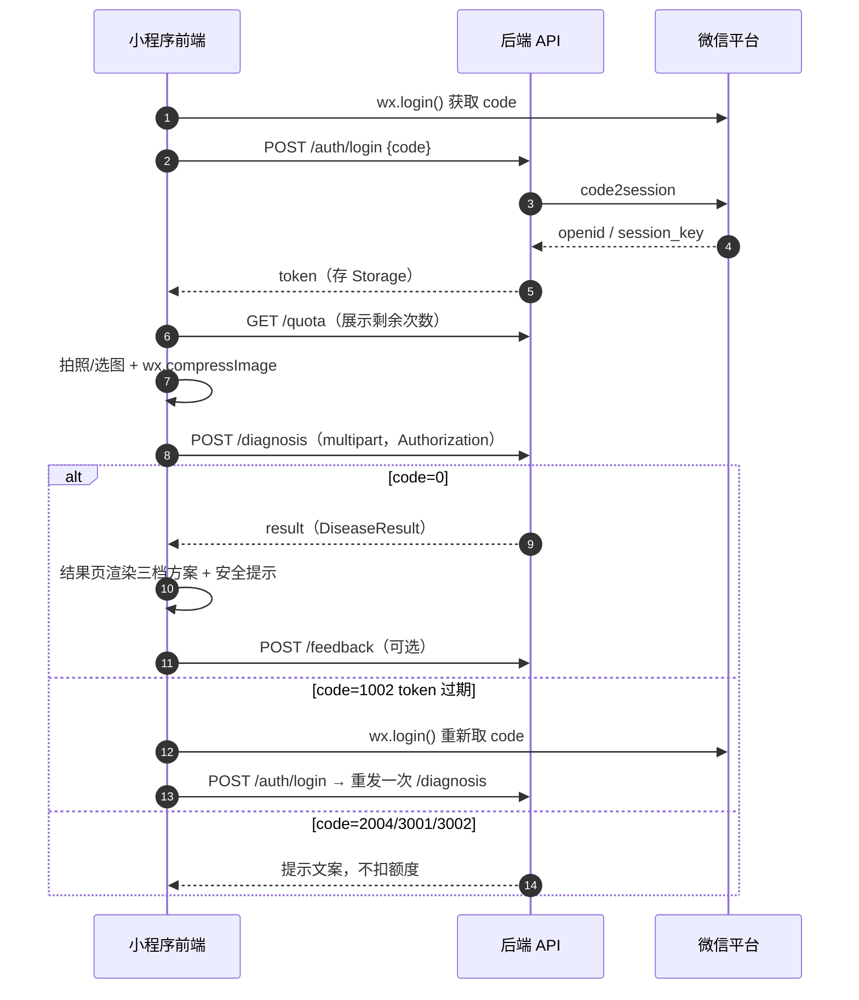

# AI 园艺医生 · 前后端 API 接口文档

> 版本：v1.0
> 协议：HTTPS + REST（JSON）
> 后端：FastAPI（自动生成 OpenAPI，`/docs` 可交互调试）
> 关联文档：[AI园艺医生-项目开发准备文档](./AI园艺医生-项目开发准备文档.md) · [任务清单](./任务清单.md)

---

## 目录

- [1. 通用约定](#1-通用约定)
- [2. 数据模型（DTO）](#2-数据模型dto)
- [3. 接口明细](#3-接口明细)
- [4. 关键业务流程](#4-关键业务流程)
- [5. 错误码总表](#5-错误码总表)
- [6. 前端调用示例（小程序）](#6-前端调用示例小程序)
- [7. 接口与功能/任务映射](#7-接口与功能任务映射)
- [8. 联调约定](#8-联调约定)

---

## 1. 通用约定

### 1.1 环境与 Base URL

> **当前项目状态：还没有购买域名。** 开发阶段（W1–W3）用本地地址 + 开发者工具"不校验合法域名"即可跑通，不受影响；测试/生产域名购买并完成 ICP 备案后，把下表的 `example.com` 占位符全局替换即可。详见准备文档 [7.2 域名规划](./AI园艺医生-项目开发准备文档.md)。

| 环境 | Base URL | 说明 |
| --- | --- | --- |
| 开发 | `http://127.0.0.1:8000/api/v1` | 本地，小程序需勾选"不校验合法域名、web-view、TLS 版本以及 HTTPS 证书" |
| 真机调试 | `http://内网穿透域名/api/v1` | 可选，用 frp/cpolar 临时域名，仅供自测，不能提审 |
| 测试 | `https://api-test.example.com/api/v1` | 需已备案域名 + HTTPS（占位符，买域名后替换） |
| 生产 | `https://api.example.com/api/v1` | 上线环境，必须 HTTPS 且已 ICP 备案 |

> 小程序端 baseUrl 写在 `config.js`，按 `dev/prod` 切换，**禁止把本地 IP 提交上线**。

### 1.2 统一响应结构

所有接口（含错误）遵循同一结构：

```json
{
  "code": 0,
  "message": "ok",
  "data": {},
  "trace_id": "b1f2c3d4e5a6478"
}
```

| 字段 | 类型 | 说明 |
| --- | --- | --- |
| `code` | int | 业务码，`0` 表示成功，非 0 见[第 5 章](#5-错误码总表) |
| `message` | string | 提示文案，可直接展示给用户（中文） |
| `data` | object/null | 业务数据，失败时为 `null` |
| `trace_id` | string | 单次请求追踪 ID，出问题排查时提供给后端 |

**HTTP 状态码使用规则**

| HTTP | 使用场景 |
| --- | --- |
| `200` | 请求已被正常处理（业务成败看 `code`） |
| `401` | 未登录 / token 失效（前端应触发重新登录） |
| `403` | 无权限（如非管理员访问后台） |
| `413` | 请求体过大（图片超限） |
| `429` | 触发限流或额度耗尽 |
| `500` | 服务端未捕获异常 |

> 约定：**业务判断以 `code` 为准**，不要只看 HTTP 状态码。

### 1.3 鉴权

| 项 | 约定 |
| --- | --- |
| 登录换取 | `POST /auth/login` → 返回 `token` |
| 携带方式 | 请求头 `Authorization: Bearer <token>` |
| 有效期 | 7 天；过期返回 `code=1002`，前端静默重新登录后重发一次 |
| 免鉴权接口 | `/auth/login`、`/diseases*`、`/health`、`/admin/login` |
| 存储 | 小程序 `wx.setStorageSync('token', token)` |

### 1.4 通用参数与格式

| 项 | 约定 |
| --- | --- |
| 时间 | ISO 8601 字符串，东八区：`2026-10-17T12:00:00+08:00` |
| ID | **以字符串返回**（避免 JS Number 精度丢失） |
| 分页入参 | `page`（从 1 开始，默认 1）、`page_size`（默认 20，最大 50） |
| 分页出参 | `{ list, total, page, page_size, has_more }` |
| 金额/成本 | 单位元，保留 4 位小数 |
| 枚举 | 全部小写下划线风格，见各接口说明 |

### 1.5 请求上下文与幂等

| 项 | 约定 |
| --- | --- |
| 客户端时间 | 可选字段 `client_ts`（毫秒时间戳），用于排查用户侧耗时 |
| 幂等 | `POST /diagnosis` 用 `image_hash` 做缓存去重；相同图片在缓存有效期内不重复计费 |
| 重试 | 前端仅对超时做 **1 次**自动重试，避免重复扣额度 |
| 超时 | 前端 `timeout` 建议 20000ms（识别链路较长） |

---

## 2. 数据模型（DTO）

### 2.1 User

| 字段 | 类型 | 说明 |
| --- | --- | --- |
| `id` | string | 用户 ID |
| `nickname` | string | 昵称 |
| `avatar_url` | string | 头像地址 |
| `created_at` | string | 注册时间 |
| `last_login_at` | string | 最近登录时间 |

### 2.2 DiagnosisRecord

| 字段 | 类型 | 说明 |
| --- | --- | --- |
| `id` | string | 记录 ID |
| `image_urls` | string[] | 图片地址（1–3 张，按上传顺序） |
| `status` | string | `created` / `recognizing` / `success` / `degraded` / `failed` / `corrected` |
| `result` | object\|null | 识别结果（见 2.3），降级与失败时为 `null` 或有降级标识 |
| `confidence` | number | 置信度 0–1，冗余字段便于列表展示 |
| `disease_name` | string\|null | 病虫害名称，冗余字段便于列表展示 |
| `latency_ms` | int | 后端识别耗时 |
| `created_at` | string | 创建时间 |

### 2.3 DiseaseResult（核心结构体）

这是**大模型输出契约**，也是前端结果页的渲染依据，字段不可随意增删。

| 字段 | 类型 | 说明 |
| --- | --- | --- |
| `disease_name` | string | 病虫害名称；无法判断时为 `"无法识别"` |
| `aliases` | string[] | 别名 |
| `category` | string | `真菌性病害` / `细菌性病害` / `病毒性病害` / `虫害` / `生理性病害` |
| `confidence` | number | 置信度 0–1；**≤ 0.5 时前端必须展示补拍引导** |
| `severity` | string | `mild` / `moderate` / `severe` |
| `symptom_summary` | string | 症状描述 |
| `confirm_points` | string[] | 症状确认点，供用户自行核对 |
| `confused_with` | object[] | 易混淆项 `{ name, key_difference }` |
| `plan_l1_safe` | object | 家庭安全处置 `{ title, items: string[] }` |
| `plan_l2_low_toxicity` | object | 低毒合规处置 `{ title, items: object[], note }` |
| `plan_l3_professional` | object | 专业干预 `{ title, items: string[], risk_note }` |
| `safety_notes` | string[] | 安全提示（儿童/宠物），**前端固定高亮展示** |
| `need_more_info` | bool | 是否需要更多信息 |
| `followup_questions` | string[] | 需要补充的信息 / 补拍建议 |

**完整示例**

```json
{
  "disease_name": "番茄早疫病",
  "aliases": ["轮纹病"],
  "category": "真菌性病害",
  "confidence": 0.86,
  "severity": "moderate",
  "symptom_summary": "叶片出现深褐色同心轮纹斑，边缘黄化，下部老叶先发病。",
  "confirm_points": [
    "病斑有同心轮纹（靶心状）",
    "从下部老叶向上发展",
    "高湿环境下病斑边缘有浅色霉层"
  ],
  "confused_with": [
    { "name": "番茄晚疫病", "key_difference": "晚疫病斑边缘不清晰、水渍状，扩展极快" }
  ],
  "plan_l1_safe": {
    "title": "家庭零风险处置（有儿童/宠物首选）",
    "items": [
      "立即摘除病叶病果，装袋密封丢弃，不要丢进堆肥",
      "增加通风，避免叶面长时间挂水",
      "基部浇水，不要从叶面淋水"
    ]
  },
  "plan_l2_low_toxicity": {
    "title": "低毒合规处置（按说明书使用，注意安全间隔期）",
    "items": [
      { "name": "枯草芽孢杆菌", "usage": "1000 倍液叶面喷雾，7 天一次，连用 2–3 次" },
      { "name": "代森锰锌", "usage": "按登记剂量使用，采收前 15 天停止" }
    ],
    "note": "家庭阳台建议优先 L1，L2 仅在病情发展较快时使用"
  },
  "plan_l3_professional": {
    "title": "专业干预（家庭场景不建议自行操作）",
    "items": ["病情大面积爆发或反复发作时，联系当地植保站/专业园艺服务"],
    "risk_note": "涉及中高毒药剂与专业施药设备，家庭环境存在安全风险"
  },
  "safety_notes": [
    "所有药剂置于儿童与宠物接触不到处",
    "施药后洗手，当天避免宠物舔舐叶片",
    "食用部位采收前务必遵守安全间隔期"
  ],
  "need_more_info": false,
  "followup_questions": []
}
```

**前端渲染硬约定（三条，别踩坑）**

1. `plan_l1_safe` / `plan_l2_low_toxicity` / `plan_l3_professional` **三档必出**，即使某一档只有一条"不建议自行操作"也要渲染，不能因为数组为空就隐藏整块。
2. `safety_notes` 必须独立区域展示，**不允许折叠进正文**。
3. `confidence ≤ 0.5` 或 `need_more_info = true` 时，页面顶部展示 `followup_questions` 作为补拍引导。

### 2.4 Disease（知识库）

| 字段 | 类型 | 说明 |
| --- | --- | --- |
| `id` | string | 病害 ID |
| `name` | string | 名称 |
| `aliases` | string | 别名，逗号分隔 |
| `category` | string | 类别 |
| `symptoms` | string | 症状 |
| `causes` | string | 成因 |
| `plan_l1` / `plan_l2` / `plan_l3` | object | 三档方案（结构同 2.3） |
| `safety_notes` | string | 安全提示 |
| `confused_with` | string | 易混淆项 |
| `version` | int | 版本号 |

### 2.5 Feedback

| 字段 | 类型 | 说明 |
| --- | --- | --- |
| `id` | string | 反馈 ID |
| `record_id` | string | 关联诊断记录 |
| `type` | string | `like` / `dislike` / `wrong` |
| `correct_name` | string\|null | 用户填写的正确病名（`type=wrong` 时） |
| `comment` | string\|null | 补充说明 |
| `created_at` | string | 提交时间 |

### 2.6 Quota

| 字段 | 类型 | 说明 |
| --- | --- | --- |
| `stat_date` | string | 统计日期 `2026-10-17` |
| `limit_count` | int | 每日上限 |
| `used_count` | int | 已使用 |
| `remaining` | int | 剩余次数 |
| `reset_at` | string | 次日重置时间 |

---

## 3. 接口明细

接口总览：

| # | 方法 | 路径 | 说明 | 鉴权 |
| --- | --- | --- | --- | --- |
| 1 | GET | `/health` | 健康检查 | 否 |
| 2 | POST | `/auth/login` | 微信登录 | 否 |
| 3 | GET | `/user/profile` | 当前用户信息 | 是 |
| 4 | PUT | `/user/profile` | 更新昵称头像 | 是 |
| 5 | POST | `/diagnosis` | 上传图片并发起识别 | 是 |
| 6 | GET | `/diagnosis/{id}` | 查询识别结果 | 是 |
| 7 | GET | `/diagnosis` | 诊断历史（分页） | 是 |
| 8 | DELETE | `/diagnosis/{id}` | 删除记录 | 是 |
| 9 | GET | `/quota` | 今日剩余额度 | 是 |
| 10 | GET | `/diseases` | 病虫害科普列表/搜索 | 否 |
| 11 | GET | `/diseases/{id}` | 病虫害详情 | 否 |
| 12 | POST | `/feedback` | 提交反馈 | 是 |
| 13 | POST | `/admin/login` | 后台登录 | 否 |
| 14 | GET | `/admin/diseases` | 知识库列表 | 管理员 |
| 15 | POST | `/admin/diseases` | 新增病害 | 管理员 |
| 16 | PUT | `/admin/diseases/{id}` | 修改病害 | 管理员 |
| 17 | DELETE | `/admin/diseases/{id}` | 删除病害 | 管理员 |
| 18 | GET | `/admin/records` | 诊断记录查询 | 管理员 |
| 19 | GET | `/admin/stats` | 运营数据看板 | 管理员 |

---

### 3.1 健康检查

**`GET /health`**

用于部署后探活与 systemd/负载均衡健康检查。

响应：

```json
{ "code": 0, "message": "ok", "data": { "status": "up", "db": "up", "llm": "up" }, "trace_id": "..." }
```

| 字段 | 说明 |
| --- | --- |
| `db` | `up` / `down`，MySQL 连通性 |
| `llm` | `up` / `degraded`，大模型可用性（`degraded` 表示进入降级模式） |

---

### 3.2 微信登录

**`POST /auth/login`** · 免鉴权

后端用 `code` 调 `code2session`，换 `openid/session_key`，找到或创建用户，签发 token。

请求体：

```json
{
  "code": "0a1b2c3d4e5f",
  "nickname": "小园丁",
  "avatar_url": "https://thirdwx.qlogo.cn/xxx"
}
```

| 参数 | 类型 | 必填 | 说明 |
| --- | --- | --- | --- |
| `code` | string | 是 | `wx.login()` 返回的临时凭证，5 分钟有效且**只能用一次** |
| `nickname` | string | 否 | 用户授权后的昵称 |
| `avatar_url` | string | 否 | 头像地址 |

响应 `data`：

```json
{
  "token": "eyJhbGciOi...",
  "expires_in": 604800,
  "is_new_user": true,
  "user": {
    "id": "1001",
    "nickname": "小园丁",
    "avatar_url": "https://thirdwx.qlogo.cn/xxx",
    "created_at": "2026-10-17T12:00:00+08:00",
    "last_login_at": "2026-10-17T12:00:00+08:00"
  }
}
```

错误码：`2001`（code 缺失）、`1101`（code 已失效，前端应重新 `wx.login`）。

> 注意：`code` 是一次性的，前端**不要在失败后用同一个 code 重试**，必须重新调用 `wx.login()`。

---

### 3.3 当前用户信息

**`GET /user/profile`**

响应 `data`：`User` 对象（见 2.1），附加今日额度：

```json
{
  "id": "1001",
  "nickname": "小园丁",
  "avatar_url": "https://thirdwx.qlogo.cn/xxx",
  "created_at": "2026-10-17T12:00:00+08:00",
  "last_login_at": "2026-10-17T12:00:00+08:00",
  "quota": { "stat_date": "2026-10-17", "limit_count": 10, "used_count": 3, "remaining": 7, "reset_at": "2026-10-18T00:00:00+08:00" }
}
```

**`PUT /user/profile`**

请求体：`{ "nickname": "阳台种菜新手", "avatar_url": "..." }`（字段可选，仅更新传入项）

---

### 3.4 发起识别（核心接口）

**`POST /diagnosis`** · 鉴权

`Content-Type: multipart/form-data`

| 参数 | 类型 | 必填 | 说明 |
| --- | --- | --- | --- |
| `images` | file[] | 是 | 1–3 张；单张 ≤ 2MB；支持 `jpg/jpeg/png/webp`；建议长边 ≤ 1280px |
| `plant_hint` | string | 否 | 作物提示（如"番茄"），可提升准确率 |
| `client_ts` | int | 否 | 客户端时间戳（毫秒），用于耗时排查 |

请求示例（curl）：

```bash
curl -X POST https://api.example.com/api/v1/diagnosis \
  -H "Authorization: Bearer $TOKEN" \
  -F "images=@leaf1.jpg" \
  -F "images=@leaf2.jpg" \
  -F "plant_hint=番茄" \
  -F "client_ts=1760000000000"
```

响应 `data`：

```json
{
  "record_id": "1024",
  "status": "success",
  "degraded": false,
  "latency_ms": 4210,
  "remaining_quota": 7,
  "result": { "…DiseaseResult（见 2.3）…" }
}
```

| 字段 | 说明 |
| --- | --- |
| `status` | `success`（正常）/ `degraded`（降级兜底）/ `failed` |
| `degraded` | 布尔冗余，便于前端直接判断是否展示"降级"标识 |
| `remaining_quota` | 本次消耗后的剩余额度，用于结果页展示 |
| `result` | `status=success/degraded` 时为 `DiseaseResult`；`failed` 时为 `null` |

错误码：

| code | HTTP | 场景 | 前端处理 |
| --- | --- | --- | --- |
| `2002` | 200 | 图片格式不支持 | 提示换图 |
| `2003` | 413 | 图片过大或数量超限 | 提示压缩/减少数量 |
| `2004` | 200 | 内容安全不通过 | 提示图片不合规，**不扣额度** |
| `3001` | 429 | 今日额度用完 | 展示剩余重置时间 |
| `3002` | 429 | 全站成本熔断/服务繁忙 | 提示稍后重试，**不扣额度** |
| `5001` | 200 | 大模型失败已降级 | 正常展示结果 + "降级"标识 |
| `5000` | 500 | 服务端异常 | 提示重试，**不扣额度** |

> 关键约定：**失败不扣额度**（`2004` / `3002` / `5000` / `5001` 降级按成功计一次），额度扣减只发生在真正产出结果时。

**降级响应示例**

```json
{
  "record_id": "1025",
  "status": "degraded",
  "degraded": true,
  "latency_ms": 15800,
  "remaining_quota": 6,
  "result": {
    "disease_name": "番茄早疫病",
    "confidence": 0.6,
    "symptom_summary": "…来自知识库匹配结果…",
    "plan_l1_safe": { "title": "家庭零风险处置", "items": ["…"] },
    "plan_l2_low_toxicity": { "title": "低毒合规处置", "items": [], "note": "建议咨询专业人员" },
    "plan_l3_professional": { "title": "专业干预", "items": ["…"], "risk_note": "…" },
    "safety_notes": ["…"],
    "need_more_info": true,
    "followup_questions": ["建议补拍叶片背面与整株照片"]
  }
}
```

---

### 3.5 查询单条识别结果

**`GET /diagnosis/{id}`**

响应 `data`：

```json
{
  "id": "1024",
  "image_urls": ["https://cdn.example.com/u/2026/10/abc1.jpg"],
  "status": "success",
  "result": { "…DiseaseResult…" },
  "confidence": 0.86,
  "disease_name": "番茄早疫病",
  "latency_ms": 4210,
  "created_at": "2026-10-17T12:03:00+08:00"
}
```

错误码：`4001`（记录不存在）、`4002`（记录不属于当前用户，越权访问）。

> 越权访问一律返回 `4002`，**不要返回 404**，避免通过枚举探测他人记录。

---

### 3.6 诊断历史

**`GET /diagnosis`**

Query 参数：

| 参数 | 类型 | 必填 | 说明 |
| --- | --- | --- | --- |
| `page` | int | 否 | 默认 1 |
| `page_size` | int | 否 | 默认 20，最大 50 |
| `status` | string | 否 | 按状态过滤，如 `success` |

响应 `data`：

```json
{
  "list": [
    {
      "id": "1024",
      "image_urls": ["https://cdn.example.com/u/2026/10/abc1.jpg"],
      "disease_name": "番茄早疫病",
      "confidence": 0.86,
      "status": "success",
      "thumbnail": "https://cdn.example.com/u/2026/10/abc1_thumb.jpg",
      "created_at": "2026-10-17T12:03:00+08:00"
    }
  ],
  "total": 23,
  "page": 1,
  "page_size": 20,
  "has_more": true
  }
```

> 列表接口**不返回完整 `result`**，只给摘要字段 + 缩略图，降低流量；详情走 `GET /diagnosis/{id}`。

**`DELETE /diagnosis/{id}`**

软删除，返回 `{ "code": 0, "message": "ok", "data": null }`。删除后不再出现在列表。

---

### 3.7 今日额度

**`GET /quota`**

响应 `data`：`Quota` 对象（见 2.6）。

---

### 3.8 病虫害科普

**`GET /diseases`** · 免鉴权

| 参数 | 类型 | 说明 |
| --- | --- | --- |
| `keyword` | string | 关键词搜索（名称/别名） |
| `category` | string | 按类别过滤 |
| `page` / `page_size` | int | 分页 |

响应 `data`：分页结构，`list` 元素为 `Disease` 精简字段（`id`、`name`、`category`、`symptoms` 摘要）。

**`GET /diseases/{id}`** · 免鉴权

响应 `data`：完整 `Disease`（见 2.4）。

---

### 3.9 提交反馈

**`POST /feedback`**

请求体：

```json
{
  "record_id": "1024",
  "type": "wrong",
  "correct_name": "番茄晚疫病",
  "comment": "病斑没有同心轮纹，边缘是水渍状"
}
```

| 参数 | 类型 | 必填 | 说明 |
| --- | --- | --- | --- |
| `record_id` | string | 是 | 必须是本人记录，否则 `4002` |
| `type` | string | 是 | `like` / `dislike` / `wrong` |
| `correct_name` | string | 否 | `type=wrong` 时建议必填 |
| `comment` | string | 否 | 最长 200 字（超长 `2001`） |

响应 `data`：`{ "feedback_id": "301", "record_status": "corrected" }`

> 成功提交后会将该记录的 `status` 置为 `corrected`，形成纠错闭环。

---

### 3.10 后台管理接口

**`POST /admin/login`** · 免鉴权

请求：`{ "username": "admin", "password": "******" }`
响应：`{ "token": "...", "expires_in": 43200 }`（后台 token 与用户 token 分离，有效期 12 小时）

**`GET /admin/diseases`** · 管理员

支持 `keyword`、`category`、`page`、`page_size`，返回含 `version` 的完整病害列表。

**`POST /admin/diseases`** · 管理员

请求体：`Disease` 的写入字段（`name` 必填且唯一，`plan_l1/l2/l3` 结构同 2.3）。
响应：`{ "id": "55", "version": 1 }`

**`PUT /admin/diseases/{id}`** · 管理员

请求体同上（部分更新），`version` 自增。响应：`{ "id": "55", "version": 2 }`

**`DELETE /admin/diseases/{id}`** · 管理员

**`GET /admin/records`** · 管理员

| 参数 | 类型 | 说明 |
| --- | --- | --- |
| `user_id` | string | 按用户过滤 |
| `status` | string | 按状态过滤 |
| `start_date` / `end_date` | string | 日期区间 `2026-10-01` |
| `page` / `page_size` | int | 分页 |

**`GET /admin/stats`** · 管理员

| 参数 | 类型 | 说明 |
| --- | --- | --- |
| `from` | string | 起始日期，默认 7 天前 |
| `to` | string | 结束日期，默认今天 |

响应 `data`：

```json
{
  "days": [
    {
      "stat_date": "2026-10-17",
      "total_calls": 320,
      "success_calls": 298,
      "degraded_calls": 15,
      "failed_calls": 7,
      "success_rate": 0.931,
      "avg_latency_ms": 4300,
      "p95_latency_ms": 7800,
      "total_cost_cny": 12.4800,
      "new_users": 88
    }
  ],
  "summary": {
    "total_calls": 2140,
    "success_rate": 0.94,
    "total_cost_cny": 86.2500
  }
}
```

---

## 4. 关键业务流程

### 4.1 首次进入与识别主流程



### 4.2 前端页面与接口对应

| 页面 | 调用接口 | 时机 |
| --- | --- | --- |
| 首页 | `GET /quota`、`GET /diseases` | `onShow` |
| 拍照/上传 | `POST /diagnosis` | 用户点"开始识别" |
| 结果页 | `POST /diagnosis`（同步返回）、`GET /diagnosis/{id}`（回看） | 进入页面 |
| 历史列表 | `GET /diagnosis` | `onShow` + 下拉刷新 + 触底加载 |
| 历史详情 | `GET /diagnosis/{id}` | 进入页面 |
| 反馈 | `POST /feedback` | 提交 |
| 个人中心 | `GET /user/profile` | `onShow` |

---

## 5. 错误码总表

### 5.1 通用与鉴权

| code | HTTP | message | 说明 | 前端处理 |
| --- | --- | --- | --- | --- |
| `0` | 200 | ok | 成功 | — |
| `1001` | 401 | 请先登录 | 缺少 token | 触发静默登录 |
| `1002` | 401 | 登录已过期 | token 失效/过期 | 重新登录并重发一次 |
| `1003` | 403 | 无权限访问 | 非管理员等 | 跳回首页 |
| `2001` | 200 | 参数不合法 | 参数校验失败 | 定位到具体字段提示 |
| `5000` | 500 | 服务开小差了 | 未捕获异常 | 提示重试，不扣额度 |

### 5.2 识别与额度

| code | HTTP | message | 说明 |
| --- | --- | --- | --- |
| `2002` | 200 | 图片格式不支持 | 仅支持 jpg/jpeg/png/webp |
| `2003` | 413 | 图片过大或数量超限 | 单张 > 2MB 或超过 3 张 |
| `2004` | 200 | 图片内容不合规 | 内容安全未通过，不扣额度 |
| `3001` | 429 | 今日免费次数已用完 | 次日 0 点重置 |
| `3002` | 429 | 当前使用人数较多 | 熔断/限流，不扣额度 |
| `4001` | 200 | 记录不存在 | 记录已删除或 ID 错误 |
| `4002` | 200 | 无权访问该记录 | 越权访问 |
| `5001` | 200 | 识别已降级 | 大模型失败，返回知识库兜底结果 |

### 5.3 登录与后台

| code | HTTP | message | 说明 |
| --- | --- | --- | --- |
| `1101` | 200 | 微信凭证已失效 | `code` 已被使用或过期，需重新 `wx.login()` |
| `1102` | 200 | 微信服务不可用 | `code2session` 调用失败 |
| `6001` | 200 | 账号或密码错误 | 后台登录失败 |
| `6002` | 200 | 病害名称已存在 | 知识库新增重名 |

---

## 6. 前端调用示例（小程序）

### 6.1 统一请求封装

```javascript
// utils/request.js
const BASE_URL = require('../config').baseUrl; // 按环境切换
let isRefreshing = false;

function request(options) {
  return new Promise((resolve, reject) => {
    wx.request({
      url: BASE_URL + options.url,
      method: options.method || 'GET',
      data: options.data || {},
      timeout: 20000,
      header: {
        'content-type': 'application/json',
        ...(wx.getStorageSync('token')
          ? { Authorization: 'Bearer ' + wx.getStorageSync('token') }
          : {})
      },
      success(res) {
        const body = res.data || {};
        if (body.code === 0) return resolve(body.data);
        if (body.code === 1001 || body.code === 1002) {
          // token 失效：静默登录后重发一次，注意防止无限递归
          return relogin().then(() => request(options)).then(resolve).catch(reject);
        }
        wx.showToast({ title: body.message || '请求失败', icon: 'none' });
        reject(body);
      },
      fail(err) {
        wx.showToast({ title: '网络异常，请重试', icon: 'none' });
        reject(err);
      }
    });
  });
}
```

### 6.2 图片上传（`wx.uploadFile` 的坑）

```javascript
// utils/image.js
function uploadDiagnosis(files, plantHint) {
  const token = wx.getStorageSync('token');
  return new Promise((resolve, reject) => {
    wx.uploadFile({
      url: BASE_URL + '/diagnosis',
      filePath: files[0].tempFilePath,
      name: 'images',                       // 字段名必须是 images
      header: { Authorization: 'Bearer ' + token }, // 不要手动设 content-type
      formData: { plant_hint: plantHint || '', client_ts: Date.now() },
      timeout: 30000,
      success(res) {
        // uploadFile 返回的 res.data 是字符串，必须手动解析
        let body;
        try { body = JSON.parse(res.data); }
        catch (e) { return reject(new Error('响应解析失败')); }
        if (body.code === 0) return resolve(body.data);
        wx.showToast({ title: body.message, icon: 'none' });
        reject(body);
      },
      fail: reject
    });
  });
}
```

> 两个最容易翻车的点：① `wx.uploadFile` 的 `res.data` 是字符串，不 parse 会直接炸；② 多图需**多次上传或改用 `wx.request` + FormData 方案**，MVP 建议限制 1–3 张并在前端做顺序控制。

### 6.3 图片压缩（先压缩再上传）

```javascript
wx.compressImage({
  src: tempFilePath,
  quality: 70,
  success: res => { /* 用 res.tempFilePath 上传 */ }
});
// 长边 > 1280px 时建议再用 canvas 缩放一次，避免无谓的 Token 消耗
```

---

## 7. 接口与功能/任务映射

| 功能需求（准备文档 FR） | 对应接口 | 对应任务（任务清单 ID） |
| --- | --- | --- |
| FR-01 微信一键登录 | `POST /auth/login` | T1.4 |
| FR-02 拍照/相册选图 | 客户端能力，无接口 | T2.2 |
| FR-03 图片预处理 | 客户端压缩 + `POST /diagnosis` 校验 | T2.1, T2.2 |
| FR-04 多模态识别 | `POST /diagnosis` | T2.3, T2.4 |
| FR-05 分层防治方案展示 | `POST /diagnosis` 返回 `DiseaseResult` | T2.5 |
| FR-06 置信度与不确定性 | `confidence` / `need_more_info` / `followup_questions` | T2.6 |
| FR-07 诊断历史 | `GET /diagnosis`、`GET /diagnosis/{id}` | T3.1 |
| FR-08 反馈纠错 | `POST /feedback` | T3.2 |
| FR-09 免费额度与限流 | `GET /quota`、`POST /diagnosis`（3001/3002） | T3.3 |
| FR-10 订阅消息提醒 | 待定（P2） | — |
| FR-11 知识库管理 | `/admin/diseases*` | T3.5 |
| FR-12 内容安全检测 | `POST /diagnosis`（2004）、后续 `msgSecCheck` 扩展 | T3.4 |
| 降级兜底 | `POST /diagnosis`（`status=degraded`） | T3.6 |
| 数据看板 | `GET /admin/stats` | T3.7 |

---

## 8. 联调约定

| 项 | 约定 |
| --- | --- |
| Mock 优先 | 后端接口未就绪时，前端用本地 mock JSON（字段严格对齐 2.3）先跑通 UI |
| 字段冻结 | `DiseaseResult` 的结构一旦冻结，改字段必须同步改前端渲染与 Prompt Schema，三方同改 |
| trace_id | 前端报错时把 `trace_id` 一并展示在错误提示或复制到剪贴板，方便后端定位日志 |
| 超时与重试 | 识别接口前端超时 30s；仅失败时允许 1 次重试，**避免重复扣额度** |
| 图片域名 | 图片地址使用独立 CDN/存储域名，需加入小程序 `downloadFile` 合法域名；**没有域名期间**可先由后端静态目录（`/static/...`）返回图片，本地调试不受限，上线前再切到已备案域名 |
| 联调检查点 | ① 未登录调用识别返回 1001；② token 过期自动续期且只重发一次；③ 额度耗尽返回 3001 且不扣费；④ 断网/大模型故障走降级；⑤ 越权访问返回 4002 |

---

**文档结束** · 后端实现后可直接用 FastAPI 的 `/docs`（Swagger）与本文档交叉核对，两者字段应完全一致。
